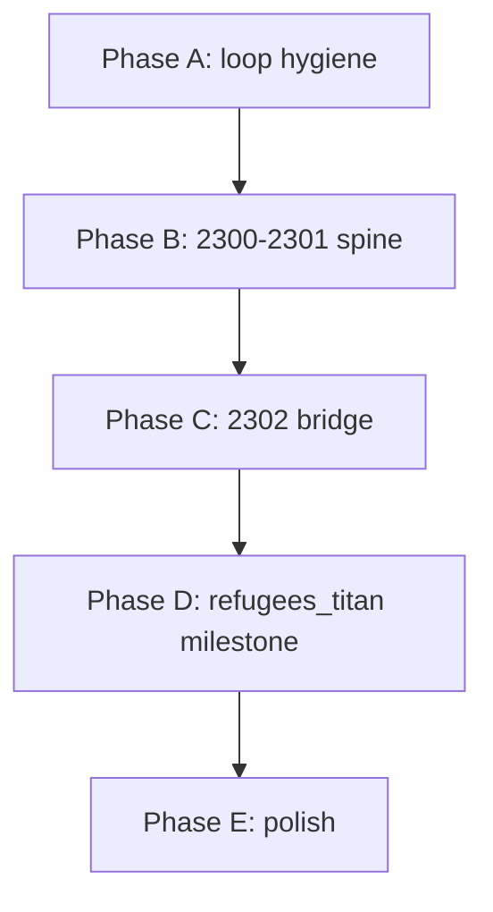

# Mikasa — implementation roadmap

Living inventory of what exists in `source/`, plus a plan to reach the **refugee crisis opening** ([`refugees_titan.scene.dry`](source/scenes/major/refugees_titan.scene.dry), February 2302).

**Monthly loop:** [`advance.scene.dry`](source/scenes/advance.scene.dry) → [`post_event.scene.dry`](source/scenes/post_event.scene.dry) (tick + `#event` queue) → [`main.scene.dry`](source/scenes/main.scene.dry).

**New game:** [`root.scene.dry`](source/scenes/root.scene.dry) `@start` → runtime bootstrap [`setup_functions.scene.dry`](source/scenes/setup_functions.scene.dry) → [`main.scene.dry`](source/scenes/main.scene.dry). Prologue text continues at [`root.scene.dry`](source/scenes/root.scene.dry) `@2300_main_continue` → [`organize_phase_start.scene.dry`](source/scenes/cards/local_organizing/organize_phase_start.scene.dry).

---

## Background / runtime mechanics

These scenes load once (or each boot), define APIs on `Q`, and are not player-facing cards.

| Mechanic | Scene | Notes |
|--------|--------|--------|
| Boot orchestration | [`setup_functions.scene.dry`](source/scenes/setup_functions.scene.dry) | Chains runtime scenes until election, electorate, economic, attitude, and organize APIs exist. |
| Election v2 (tabulation, seats, projections) | [`election_runtime.scene.dry`](source/scenes/election_runtime.scene.dry) | Source of truth for voter blocks, districts, IG boosts. Dev mirror: `source/lib/election-v2.js`. |
| Electorate modifier catalog | [`electorate_runtime.scene.dry`](source/scenes/electorate_runtime.scene.dry) | `ElectorateModifier` rows; stacks from story choices (`dundalk_*`, contracts, cable neg, refugee prep, …). |
| Economic assets & housing | [`economic_assets_runtime.scene.dry`](source/scenes/economic_assets_runtime.scene.dry) | `Q.addAsset` / `Q.addHome`, Jacobs report, monthly housing, budget hooks. |
| IG leverage / reprisal → attitude labels | [`attitude_runtime.scene.dry`](source/scenes/attitude_runtime.scene.dry) | `Q.syncIgAttitudes()`, used in [`status.scene.dry`](source/scenes/status.scene.dry). |
| Monthly economy & prosperity mesh | [`organize_phase_tick.scene.dry`](source/scenes/cards/local_organizing/organize_phase_tick.scene.dry) | `Q.monthly_tick_phase1`: trade level, prosperity connections, contracting allowance, cable promise tick, cable syndicate event-ready flags. Catalog doc: [`prosperity_connection_catalog.md`](source/scenes/cards/local_organizing/prosperity_connection_catalog.md). |
| District map (special UI) | [`district_map_runtime.scene.dry`](source/scenes/district_map_runtime.scene.dry), [`district_map.scene.dry`](source/scenes/district_map.scene.dry) | Map overlay support. |
| Mod loader hook | [`mod_loader.scene.dry`](source/scenes/mod_loader.scene.dry) | Shell integration. |
| Crime paramilitary (QNM balances) | [`crime_paramilitary_runtime.scene.dry`](source/scenes/crime_paramilitary_runtime.scene.dry) | `calc*` / `apply*` templates; monthly tick not wired yet. |
| Corp conflict infra tick (legacy) | [`background/corp_conflict.scene.dry`](source/scenes/background/corp_conflict.scene.dry) | Mutates `district*_infra` from corp relations; **not wired into post_event tick**. |
| Journey chapter gate (stub) | [`background/mikasa_journey_inbound.scene.dry`](source/scenes/background/mikasa_journey_inbound.scene.dry) | Sets `mikasa_journey_leg`; triggered from [`post_event.scene.dry`](source/scenes/post_event.scene.dry) at 2302-01+. |
| Election scheduling helper | [`set_next_election_time.scene.dry`](source/scenes/set_next_election_time.scene.dry) | Internal / dev. |
| Q-display labels | [`source/qdisplays/*.qdisplay.dry`](source/qdisplays/) | Month names, prosperity bands, attitudes, parochialism, etc. |
| Game metadata | [`source/info.dry`](source/info.dry) | Title / author for build. |

**UI / meta (not simulation):** [`status.scene.dry`](source/scenes/status.scene.dry), [`library.scene.dry`](source/scenes/library.scene.dry), [`election_simulation.scene.dry`](source/scenes/election_simulation.scene.dry), [`game_over.scene.dry`](source/scenes/game_over.scene.dry), [`credits.scene.dry`](source/scenes/credits.scene.dry), [`return.scene.dry`](source/scenes/return.scene.dry), [`cancel_advisor_action.scene.dry`](source/scenes/cancel_advisor_action.scene.dry).

**District flavor (read-only):** [`districts/*.scene.dry`](source/scenes/districts/) — Docks, Aurora, Vats, Railyard, Pitts, Limelight, Deeps. Crime/prosperity labels today come from [`election_runtime.scene.dry`](source/scenes/election_runtime.scene.dry) `Q.syncDistrictDisplays()` (prosperity + G/H poll proxy only; **no monthly tick**). See **District crime (ready to implement)** below.

**Advisors (partial):** [`advisors/jacobs.scene.dry`](source/scenes/advisors/jacobs.scene.dry), [`stacy.scene.dry`](source/scenes/advisors/stacy.scene.dry), [`callista.scene.dry`](source/scenes/advisors/callista.scene.dry), [`sage.scene.dry`](source/scenes/advisors/sage.scene.dry) — `#advisor` deck include is **commented out** in [`main.scene.dry`](source/scenes/main.scene.dry).

### District crime (ready to implement)

**Design:** [`source/scenes/planning/crime_paramilitary.md`](source/scenes/planning/crime_paramilitary.md) — paramilitary **QNM** (quality × numbers × morale), dominance ratio **`R = outlaw_mass / LE`**, **threshold bands** (no continuous curve). Crime and warfare collateral share the same faction ledger.

**Implement:**

1. **Monthly tick** in [`organize_phase_tick.scene.dry`](source/scenes/cards/local_organizing/organize_phase_tick.scene.dry) `monthly_tick_phase1` (or dedicated `MIKASA_CRIME_PARAMILITARY_*` runtime scene).
2. Per-district `<district>_crime` from `R` bands + `<district>_crime_modifier` − `crime_relief_*`; ~80/20 local/city spillover; population-weighted `Q.crime_level`. War pairs: raid progress → housing/asset destruction + `Q.monthly_raid_report` on [`main`](source/scenes/main.scene.dry).
3. Replace display stub in `Q.syncDistrictDisplays()` ([`election_runtime.scene.dry`](source/scenes/election_runtime.scene.dry)); label via [`crime.qdisplay.dry`](source/qdisplays/crime.qdisplay.dry).
4. Hook cards: [`security`](source/scenes/cards/city_affairs/security.scene.dry), [`militia_degrade`](source/scenes/cards/city_affairs/militia_degrade.scene.dry), [`community_outreach`](source/scenes/cards/local_organizing/community_outreach.scene.dry).

**Already partial:** drone affluence bribery in [`electorate_runtime.scene.dry`](source/scenes/electorate_runtime.scene.dry) (`syncSyndicateDroneWealthStacks`) — separate from `R`, not part of paramilitary tick.

**Still open:** initial QNM values at new game, exact band constants, corp-war attrition; see design doc tuning section.

---

## Cards & events

### Hand / decks ([`main.scene.dry`](source/scenes/main.scene.dry))

| Deck | Tag | Scenes |
|------|-----|--------|
| Community Organizing | `#local_organizing` | See table below |
| City Affairs | `#city_affairs` | **`view-if: phase > 1`** — unlocks after a successful ceasefire deal ([`cable_break_negotiations`](source/scenes/major/cable_break_negotiations.scene.dry) sets `phase = 2`). |
| Advance month | pinned card | [`advance.scene.dry`](source/scenes/advance.scene.dry) |

#### `#local_organizing` cards

| Card | Scene | Gating / notes |
|------|--------|----------------|
| Activist training | [`activist_training.scene.dry`](source/scenes/cards/local_organizing/activist_training.scene.dry) | `phase >= 1`; sabotage/protest truce breaks if cable promises active. |
| Contracting | [`contracting.scene.dry`](source/scenes/cards/local_organizing/contracting.scene.dry) | `contracting_visits_remaining`; fair-chain vs patronage; assets + electorate stacks. |
| Community outreach | [`community_outreach.scene.dry`](source/scenes/cards/local_organizing/community_outreach.scene.dry) | One-shot per community; `{community}_cohesion` + `crime_relief_*` placeholders; card hidden when all five resolved. |
| Co-op economy | [`coop_economy.scene.dry`](source/scenes/cards/local_organizing/coop_economy.scene.dry) | `phase >= 1`. |
| Education | [`education.scene.dry`](source/scenes/cards/local_organizing/education.scene.dry) | `phase >= 1`. |
| Magic | [`magic.scene.dry`](source/scenes/cards/local_organizing/magic.scene.dry) | `phase >= 1`. |
| Migrations | [`migrations.scene.dry`](source/scenes/cards/local_organizing/migrations.scene.dry) | **`year >= 2302`** — one-shot; Otherworld influx / Uruk migrants (prelude to [`refugees_otherworld`](source/scenes/major/refugees_otherworld.scene.dry)). |
| Peer media | [`peer_media.scene.dry`](source/scenes/cards/local_organizing/peer_media.scene.dry) | `self_sufficiency_media = 0`. |

#### `#city_affairs` cards

| Card | Scene | Gating / notes |
|------|--------|----------------|
| Security / police reform | [`security.scene.dry`](source/scenes/cards/city_affairs/security.scene.dry) | `police_reform < 4`. |
| Municipal AI | [`municipal_ai.scene.dry`](source/scenes/cards/city_affairs/municipal_ai.scene.dry) | No extra gate. |
| Militia degrade | [`militia_degrade.scene.dry`](source/scenes/cards/city_affairs/militia_degrade.scene.dry) | `militia >= 1`, no auxiliary. |

**Planned (not implemented):** A City Affairs card to **renegotiate with the megacorps** for control of government functions the ceasefire left split — e.g. civil rights enforcement, judiciary / trials, and other levers first bargained in [`cable_break_negotiations`](source/scenes/major/cable_break_negotiations.scene.dry). Replaces the removed Weimar-era **Shuffle Cabinet** stub.

#### Industry scenes (not in main decks)

| Scene | Notes |
|--------|--------|
| [`industries/mining.scene.dry`](source/scenes/industries/mining.scene.dry) | Subsidized Pitts mining pitch; `placeholder_metal_demand`. |
| [`industries/reflector.scene.dry`](source/scenes/industries/reflector.scene.dry) | Bumps metal demand placeholder. |

---

### Scheduled events (`tags: event`)

Events appear in [`post_event.scene.dry`](source/scenes/post_event.scene.dry) `@events_choice` via `- #event`.

#### Act 1 — 2300 (organizing phase)

| When | Event | Scene |
|------|--------|--------|
| One-shot (no date; priority 1) | Political situation / unlock organizing | [`organize_phase_start.scene.dry`](source/scenes/cards/local_organizing/organize_phase_start.scene.dry) — sets `phase = 1`. |
| Oct 2300 | September Convention | [`events/september_convention.scene.dry`](source/scenes/events/september_convention.scene.dry) |

#### Act 2 — 2301 (corp war & Dundalk)

| When | Event | Scene |
|------|--------|--------|
| Jun 2301 | Tether rupture → ceasefire talks | [`major/cable_break.scene.dry`](source/scenes/major/cable_break.scene.dry) → [`major/cable_break_negotiations.scene.dry`](source/scenes/major/cable_break_negotiations.scene.dry) — successful deal sets `phase = 2` (City Affairs deck). |
| Jun–2301+ (timed) | Syndicate blind-eye op | [`events/cable_syndicate_blind_eye.scene.dry`](source/scenes/events/cable_syndicate_blind_eye.scene.dry) — if blind-eye promise + deal; honor or break choice. |
| +3 mo after deal | Raid heat (Soylent or Magrail) | [`events/cable_syndicate_raid_soylent.scene.dry`](source/scenes/events/cable_syndicate_raid_soylent.scene.dry), [`events/cable_syndicate_raid_magrail.scene.dry`](source/scenes/events/cable_syndicate_raid_magrail.scene.dry) |
| Oct 2301 | Orc marriage 1 | [`events/orc_marriage1.scene.dry`](source/scenes/events/orc_marriage1.scene.dry) |
| Nov 2301 | MSS Dundalk affair | [`events/mss_dundalk_affair.scene.dry`](source/scenes/events/mss_dundalk_affair.scene.dry) |
| Dec 2301 | Orc marriage 2 | [`events/orc_marriage2.scene.dry`](source/scenes/events/orc_marriage2.scene.dry) |
| Every December? | Drone vote buying | [`background/drone_vote_buying.dry`](source/scenes/background/drone_vote_buying.dry) — **`view-if: month = 12` only**; **affluence-driven, not crime-balance** ([`crime_paramilitary.md`](source/scenes/planning/crime_paramilitary.md)); useful → drone G↑ (**revise** when [`ig_demographics.txt`](source/scenes/planning/ig_demographics.txt) overhaul); troubling → drone C↓. |

#### Act 3 — 2302 (**refugee crisis**)

| When | Event | Scene | Status |
|------|--------|--------|--------|
| Jan 2302+ | Otherworld migrations (organizing card) | [`cards/local_organizing/migrations.scene.dry`](source/scenes/cards/local_organizing/migrations.scene.dry) | One-shot; Uruk influx / Kwendi context before Apr surge. |
| Jan 2302+ | Journey inbound (chapter gate) | [`background/mikasa_journey_inbound.scene.dry`](source/scenes/background/mikasa_journey_inbound.scene.dry) | **Stub** — only sets flag. |
| **Feb 2302** | **Attacks on Titan — crisis starts** | [`major/refugees_titan.scene.dry`](source/scenes/major/refugees_titan.scene.dry) | Sets `third_wave_on_society = 1`; prepare vs dread choice. |
| Mar 2302 | Microkipple / Earth refugees | [`major/refugees_earth.scene.dry`](source/scenes/major/refugees_earth.scene.dry) | Minimal (single acknowledgment choice). |
| Apr 2302 | Otherworld refugee surge | [`major/refugees_otherworld.scene.dry`](source/scenes/major/refugees_otherworld.scene.dry) | Minimal flavor choices. |
| After Apr 2302, `third_wave_on_society` | Abandoned ballroom housing | [`events/municipal/abandoned_ballroom.scene.dry`](source/scenes/municipal/abandoned_ballroom.scene.dry) | **Implemented** — public refugee homes in Docks. |
| Aug 2302+, `third_wave_on_society` | Aurora pyramid housing | [`events/municipal/aurora_pyramid_housing.scene.dry`](source/scenes/municipal/aurora_pyramid_housing.scene.dry) | **Partial** — defer / ICA paths have TODOs. |

#### Elections

| When | Event | Scene |
|------|--------|--------|
| `elections_this_month = 1` | District council elections | [`events/scheduled_elections.scene.dry`](source/scenes/events/scheduled_elections.scene.dry) |

#### Post-2302 / disabled / future

| Scene | Status |
|--------|--------|
| [`events/otherworld/great_protector.scene.dry`](source/scenes/events/otherworld/great_protector.scene.dry) | Aug 2306 |
| [`events/otherworld/great_protector_dispute.scene.dry`](source/scenes/events/otherworld/great_protector_dispute.scene.dry) | Jun 2305 |
| [`events/rebellion/guild_rebel_electronics.scene.dry`](source/scenes/events/rebellion/guild_rebel_electronics.scene.dry) | Partial — guild color gates; supply chain TODO |
| [`events/rebellion/clans_secret_arms.scene.dry`](source/scenes/rebellion/clans_secret_arms.scene.dry) | **Disabled** (`view-if: … and 0 = 1`) |
| [`events/rebellion/otherworld_secret_arms.scene.dry`](source/scenes/rebellion/otherworld_secret_arms.scene.dry) | **Disabled** |

---

## Cable ceasefire negotiations (major subsystem)

Design notes: [`cable_negotiations_thinking.md`](source/scenes/major/cable_negotiations_thinking.md).

**Implemented:** demands (police, tax, trials, disband, prior leverage), promise enticements (sabotage/protest truce, blind eye, raid heat, deeps tax, docks DMZ), leverage/reprisal bargaining, deal win/fail (**win → `phase = 2`**, City Affairs unlock), persisted promises, timed syndicate events, electorate + prosperity hooks, activist truce breaks.

**Still open in source:**

- [`cable_break_negotiations.scene.dry`](source/scenes/major/cable_break_negotiations.scene.dry) TODO: security-tax → budget revenue; disband → militia/city flags on finalize.
- `cable_break_peace_frail` set but **no downstream events** read it yet.
- Activist monthly protest/sabotage vs corp popularity — comment-only TBD in [`organize_phase_tick.scene.dry`](source/scenes/cards/local_organizing/organize_phase_tick.scene.dry).

---

## Achievements

[`game_over.scene.dry`](source/scenes/game_over.scene.dry): **Garden of Olives**, **Cooked Lobster** (+ `game_completed`). Icons in `out/html/img/achievement/`.

---

## Plan: playable path to refugee crisis **start** (Feb 2302)

Goal: a new player can advance from **January 2300 → January 2302**, hit the major story beats, and see **`refugees_titan`** fire as the crisis opener without dead ends or silent broken systems.

### Phase A — Core loop hygiene (blocking)

1. ~~**Advance `phase` beyond 1**~~ — **Done:** [`cable_break_negotiations`](source/scenes/major/cable_break_negotiations.scene.dry) sets `phase = 2` when ≥2 megacorps accept the ceasefire (Jun 2301). Optionally tie [`organize_phase_tick`](source/scenes/cards/local_organizing/organize_phase_tick.scene.dry) trade-level `phase` bands to calendar elsewhere.
2. ~~**Remove SPD leftovers**~~ — **Done:** deleted [`shuffle_cabinet.scene.dry`](source/scenes/cards/city_affairs/shuffle_cabinet.scene.dry). **Next:** design a `#city_affairs` card to renegotiate corp control of civil rights, judiciary, and related government levers (see table above).
3. **Fix [`organize_phase_start`](source/scenes/cards/local_organizing/organize_phase_start.scene.dry) entry** — Either gate it to Jan 2300 month 1 (first `post_event`) or chain explicitly from [`root`](source/scenes/root.scene.dry) `@2300_main_continue` so `phase >= 1` is guaranteed before October events.
4. **Date-gate [`drone_vote_buying`](source/scenes/background/drone_vote_buying.dry)** — Add `year`, `max-visits`, or remove until designed; avoid firing every December forever.

### Phase B — 2300–2301 story spine (content)

5. ~~**September Convention fallout**~~ — **Done:** [`september_convention`](source/scenes/events/september_convention.scene.dry) permit bumps `parochialism`; ban cuts `parochialism` / `parochial_radicalism` and stacks `first_wave_ban_slights` (first-stratum poll modifiers in [`electorate_runtime`](source/scenes/electorate_runtime.scene.dry)).
6. ~~**Migrations card window**~~ — **Done:** [`migrations`](source/scenes/cards/local_organizing/migrations.scene.dry) now **`year >= 2302`** (was Jan–May 2300); problem/opportunity subscenes still need stack wiring if desired.
7. **Cable arc polish** — Close negotiation TODOs (tax → budget, disband flags); smoke-test syndicate timed events from a Jun 2301 deal through +1 / +3 months.
8. ~~**Dundalk + orc events**~~ — **Done (orc):** [`orc_marriage2`](source/scenes/events/orc_marriage2.scene.dry) sets `orc_marriage_*` stacks; stratum poll shifts in [`electorate_runtime`](source/scenes/electorate_runtime.scene.dry). Dundalk stacks already wired; verify martyrs in [`status`](source/scenes/status.scene.dry) if needed.

### Phase C — Bridge to 2302 (refugee runway)

9. **Implement [`mikasa_journey_inbound`](source/scenes/background/mikasa_journey_inbound.scene.dry)** — Short narrative + any flags needed before Titan (or remove hijack from [`post_event`](source/scenes/post_event.scene.dry) if unnecessary). Today it fires **before** Feb crisis and does nothing visible.
10. **Refugee prelude qualities** — Optionally add 2301 foreshadowing (library / peer media / status) referencing Jovian clan wars and kipple so Feb–Apr events aren't the first mention.
11. **Election coverage Jan 2300–Jan 2302** — Confirm [`runScheduledElections`](source/scenes/election_runtime.scene.dry) fires for all district months on calendar; player sees [`scheduled_elections`](source/scenes/events/scheduled_elections.scene.dry) at least twice before 2302.

### Phase D — Refugee crisis **start** (milestone deliverable)

12. **Verify Feb 2302 trigger** — [`refugees_titan`](source/scenes/major/refugees_titan.scene.dry): `jovian_refugee_prepare` / `jovian_refugee_dread` stacks already wired in [`electorate_runtime`](source/scenes/electorate_runtime.scene.dry); playtest that `third_wave_on_society = 1` unlocks third-wave prosperity row in [`status`](source/scenes/status.scene.dry).
13. **Minimal follow-through for Mar–Apr** — Expand [`refugees_earth`](source/scenes/major/refugees_earth.scene.dry) and [`refugees_otherworld`](source/scenes/major/refugees_otherworld.scene.dry) with at least one meaningful stack or budget/housing pressure each (crisis **continues**, but start is Feb Titan).
14. **Smoke test full timeline** — Dev cheat or `npm run`-style month advance: 2300-01 → 2302-02 in one session; no JS errors; main deck always has Advance; organizing cards appear after unlock.

### Phase E — Nice-to-have before playtesting wider (non-blocking for “crisis start”)

- **Implement district crime / paramilitary tick** — [`crime_paramilitary.md`](source/scenes/planning/crime_paramilitary.md) (QNM ledger, `R` threshold bands, modifier stacks).
- Wire [`corp_conflict`](source/scenes/background/corp_conflict.scene.dry) into monthly tick while `cable_break_peace = 0`.
- Enable `#advisor` deck with Mikasa conditions.
- Hook [`industries/mining`](source/scenes/industries/mining.scene.dry) into organizing or city deck.
- Third-wave voter blocks in [`election_runtime`](source/scenes/election_runtime.scene.dry) if elections should shift after `third_wave_on_society`.

---

## Suggested implementation order

**Definition of done for this roadmap:** Player reaches **February 2302**, [`refugees_titan`](source/scenes/major/refugees_titan.scene.dry) fires with working choices, `third_wave_on_society` is set, and the monthly loop (organizing cards, elections, cable aftermath, status screen) remains playable.

---

## Related docs

- [`source/election_system.md`](source/election_system.md)
- [`source/lib/election-v2.md`](source/lib/election-v2.md)
- [`source/scenes/cards/local_organizing/prosperity_connection_catalog.md`](source/scenes/cards/local_organizing/prosperity_connection_catalog.md)
- [`source/scenes/major/cable_negotiations_thinking.md`](source/scenes/major/cable_negotiations_thinking.md)
- [`source/scenes/planning/crime_paramilitary.md`](source/scenes/planning/crime_paramilitary.md) — district crime / QNM paramilitary tick (design ready)
