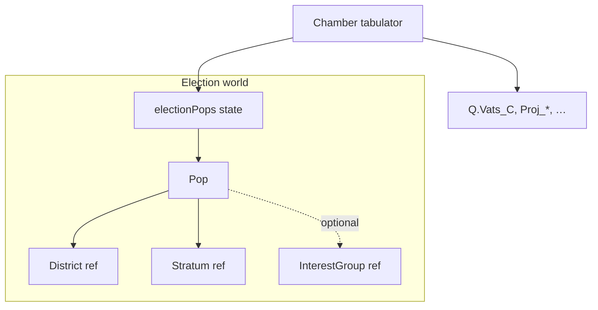

# Pop object sketch (working doc)

Scratch pad for the Paradox-style pop model on `feature/pop-election`. Implementation lives in `pop_election_runtime.scene.dry`; migration checklist in [`pop_election.md`](pop_election.md).

---

## Design goals

- [ ] Replace **one VoterBlock per (stratum × district)** with **many pops** that can diverge within that cell
- [ ] Keep **flat `Q` seat output** unchanged (`Vats_C`, `Proj_*`, `Exec_*`, …)
- [ ] Cards/events target **pops or pop queries**, not raw block IDs
- [ ] Deterministic tabulation (no RNG except explicit card-draw mechanics)
- [ ] Save/load: pops serialise to qualities or rebuild from seed + drift log (pick one ↓)

---

## Object graph (draft)



**Open:** Do we keep `District` / `Demographic` classes as registries, or flatten to IDs on each pop?

| Option | Pros | Cons |
|--------|------|------|
| A. Reuse v2 `District` + `Demographic` objects | Less rewrite | Pops still coupled to old graph |
| B. ID-only on pops + lookup tables | Simple saves | Lose block-level aggregation helpers |
| C. Hybrid: registries built once, pops hold refs | Best of both | Two ways to reach district data |

**Decision:** _TBD_

---

## Pop

One pop ≈ `POP_SIZE_UNIT` people (default 1000) in one district with one primary stratum.

### Fields (sketch)

| Field | Type | Notes |
|-------|------|-------|
| `id` | string | Stable, e.g. `Vats_drone_003` |
| `districtId` | string | `Vats`, `Pitts`, … |
| `stratumId` | string | `drone`, `first`, … |
| `size` | number | Usually `POP_SIZE_UNIT`; last pop in cell may be remainder |
| `prosperity` | number | 6 = Mikasa baseline; cards bump per pop |
| `partySupport` | `{D,I,C,G,H}` | Weights or logits — **pick representation ↓** |
| `igMembership` | `{Soylent?: number, …}` | Share of pop claimed by each IG (sum ≤ 1?) |
| `turnoutMult` | number | Per-pop modifier |
| `voteRule` | string \| null | e.g. `corp_or_abstain` for drone pops |
| `competitiveSteepness` | `{D,…,H}` | From old block/demographic — still per pop? |
| `tags` | string[] | Event hooks: `organised`, `radicalised`, … |

### Party support representation

| Model | Sketch | Migration from v2 |
|-------|--------|-------------------|
| **Scores** (current block style) | additive competitive scores → softmax | Copy `competitiveScores` + steepness |
| **Shares** | `{D:0.4,C:0.35,…}` summing to 1 | Normalize after IG peel-off |
| **Issues / axes** | hidden ideology vector → party mapping | More Paradox-like; more work |

**Decision:** _TBD_

### VoterBlock → Pop mapping

Today one block = all `rich` in `Docks`. Proposed split:

```
VoterBlock(Docks, rich, pop=17)  
  → Pop(Docks, rich, size=1000) × 17   // if pop=17 means 17×10k people… clarify units
```

**Clarify:** `DISTRICT_POPULATIONS` is in **10,000s**. `POP_SIZE_UNIT = 1000` people = 0.1 × 10k. One block pop 17 → 170,000 people → **170 pops** at size 1000?

| Block field | Pop equivalent |
|-------------|----------------|
| `population` | `size` (or count of pops) |
| `prosperity` | `prosperity` |
| `competitiveScores` | `partySupport` or derived |
| `demographic.voteRule` | `voteRule` |
| `demographic.competitiveSteepness` | `competitiveSteepness` |
| IG effective membership | `igMembership` + tabulation peel |

---

## District (pop era)

Keep, slim, or drop?

| Field | Keep? | Notes |
|-------|-------|-------|
| `id` | yes | |
| `electionMonth` | yes | |
| `startingProsperity` | maybe | Default for new pops only? |
| `competitiveScores` | ? | District-wide mood vs per-pop only |
| `blocks[]` | **no** | → `pops[]` query by districtId |
| `populations[]` | seed only | Used at worldgen, not updated each tick |

**Sketch API:**

```javascript
// getPopsInDistrict(state, 'Vats')
// getPopsByStratum(state, 'drone')
// aggregateProsperity(pops) → district display stat
```

---

## Stratum / Demographic

Old `Demographic` = stratum template (national appeals, igClaimCap, executiveWeight).

| Field | On stratum template | On each pop |
|-------|---------------------|-------------|
| `competitiveScores` (base) | yes | inherited at spawn |
| `igClaimCap` | yes | enforced at tabulation |
| `executiveWeight` | yes | weight pop in exec chamber |
| `voteRule` | default | override per pop? |

**Open:** Can a pop change stratum (e.g. drone → coop)? If yes, how?

---

## InterestGroup

Largely unchanged conceptually; tabulation **claims** pop members instead of block fractions.

| Question | Notes |
|----------|-------|
| Membership per pop vs derived from stratum × district boost | v2: `effectiveMembership(block)` |
| One IG per pop or multi-IG with caps | `igClaimCap` on stratum |
| Guild IGs | Still separate chamber? |

**Sketch:**

```javascript
// igClaimedSize(pop, 'Soylent') → number
// competitiveRemainder(pop) → pop.size - sum(claims)
```

---

## PopQuery / filters (new?)

Paradox queries by culture, job, planet. We need Mikasa equivalents.

| Filter | Example use |
|--------|-------------|
| `{ districtId, stratumId }` | Organizing card targets Deeps deepers |
| `{ prosperityBelow: 5 }` | Poverty event |
| `{ tag: 'organised' }` | Strike wave |
| `{ ig: 'Families', minMembership: 0.2 }` | Syndicate pressure |

**Object or functions?** _TBD_ — start with pure functions on `electionPops.pops[]`.

---

## Tabulation pipeline (sketch)

1. **Collect** eligible pops for chamber (exec / district / guild)
2. **Peel IG** ballots from each pop (claimed share × turnout × partyShares)
3. **Competitive** remainder: softmax(partySupport + district + global modifiers)
4. **Apply vote rules** (drone abstention, etc.)
5. **Aggregate** to seats (DHondt or existing v2 method — **same as today?**)
6. **Write** `Proj_*` / committed keys on `Q`

**Open steps:** _add notes_

---

## Events & cards → pops

How does `dundalk_reform += 1` reach pops?

| Approach | Sketch |
|----------|--------|
| Modifier catalog → query → bump | Like `ElectorateModifier` but returns pop list |
| District-wide bump | All pops in Aurora +0.1 D score |
| Stratum-wide | All `drone` pops globally |
| Single pop id | Precision targeting |

**Files to touch:** `electorate_runtime`, `organize_phase_tick`, card `on-arrival`

---

## Economy / housing

`economic_assets_runtime` iterates `Q.electionV2.blocks` for homes per block.

| v2 | pops |
|----|------|
| `block.id` = `Vats_drone` | group by `(districtId, stratumId)` or per-pop inventory |
| `block.prosperity` | mean or min of grouped pops? |

**Decision:** _TBD_

---

## Save / load

| Strategy | Sketch |
|----------|--------|
| **Flat qualities** | `pop_Vats_drone_003_prosperity` — explodes count |
| **JSON blob on Q** | `Q.electionPops_blob` — one quality, parse on load |
| **Regenerate** | Seed from `DISTRICT_POPULATIONS` + apply stored deltas |
| **Hybrid** | Templates + list of pop overrides |

**Decision:** _TBD_

---

## Worldgen

```javascript
// buildPopsFromWorldData()
//   for each district in POP_DISTRICT_IDS
//     for each stratum with pop > 0
//       split into pops of POP_SIZE_UNIT
//       assign initial partySupport from Demographic + District templates
//       assign igMembership from IG_MEMBERSHIP_BY_STRATUM × DISTRICT_IG_BOOST
```

**Checklist:**

- [ ] Match total population per (district, stratum) to v2 block totals
- [ ] Deterministic IDs (no random names)
- [ ] `Q.electionPops.pops` populated
- [ ] `ready` still 0 until tabulation exists

---

## Open questions (parking lot)

1. How many pops total at default worldgen? (performance budget)
2. Splitting/merging pops when population shifts (refugee crisis)?
3. Do H pops get their own objects or stay competitive-only?
4. Political power / coalition checker: still reads seat keys only — any pop hook needed?
5. Election sim UI: aggregate pop table or stay at district level?

---

## Session notes

_Use this section for dated scratch while designing._

### YYYY-MM-DD

- 
